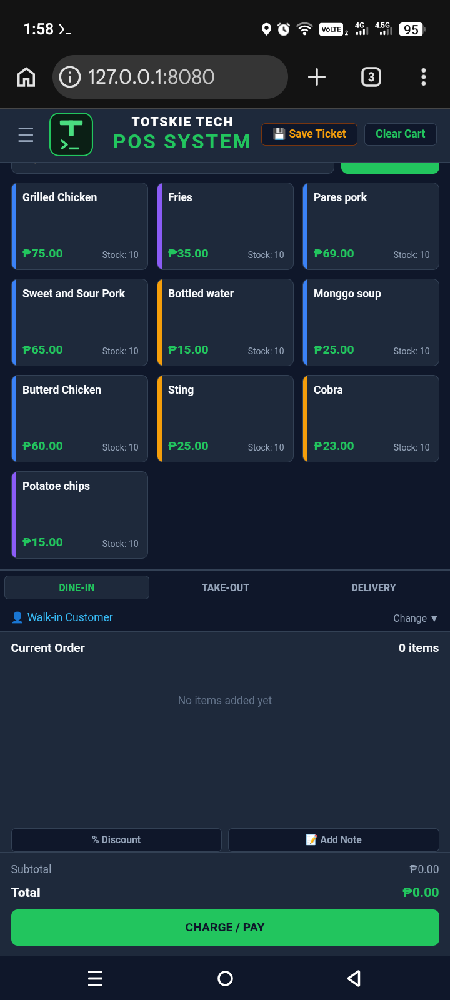
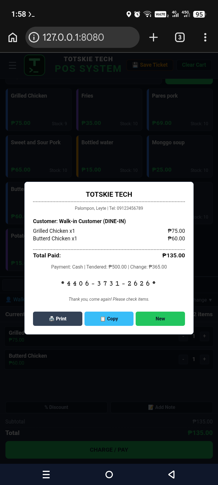
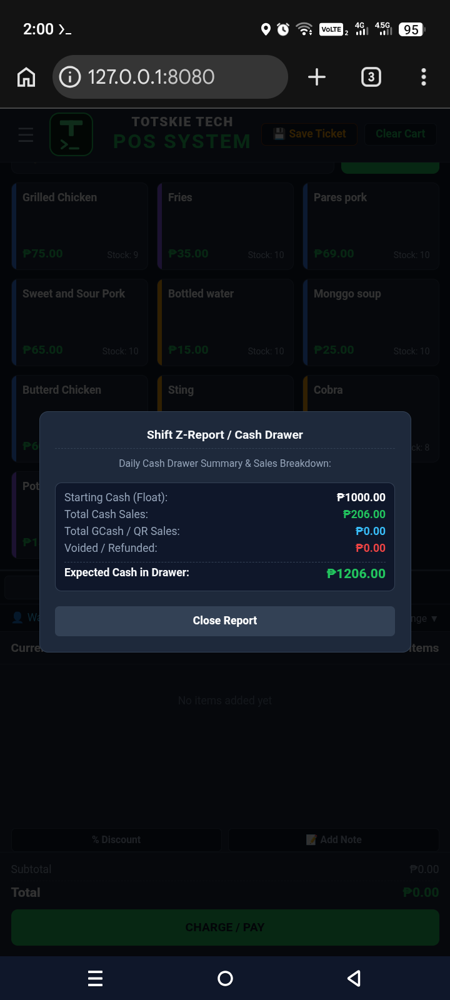

# Totskie POS

A restaurant point-of-sale web app built with Flask, SQLite and vanilla JavaScript. Works offline as a PWA on Android (Termux).

## Features

- PIN login with admin and staff roles
- Products, categories and modifiers
- Cart, cash and GCash/QR payment
- Kitchen display (KDS) with ready and remove
- Z-report with daily sales summary
- JSON API (/api/...) with JavaScript fetch
- Telegram notifications (optional)

## Run

    pip install flask
    python app.py

Open http://127.0.0.1:8080 and create the admin PIN on first run.

## Telegram (optional)

Copy telegram.example.json to telegram.json and add your own bot token and chat id.

## Screenshots

